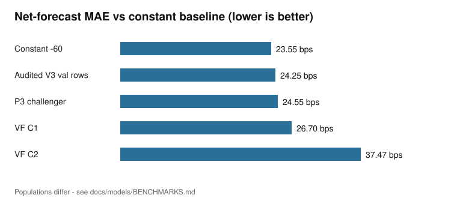

# The Gambler — Evidence-Driven Trading Research

**An open-source laboratory for causal prediction, realistic execution, paper trading, and scientifically validated learning.**

[](LICENSE)
[](https://github.com/MajidAsghariTabrizi/the-gambler-trading-lab/actions/workflows/tests.yml)
[](pyproject.toml)
[](CHANGELOG.md)
[](SECURITY.md)

> ## The Trading AI That Knows When NOT to Trade.
>
> We built a complete research platform that predicts, prices, decides, paper-trades, and *learns from its own outcomes* — then used it to prove, rigorously and repeatedly, that **none of our signals could pay the execution bill.** Across 10,478 audited decision minutes it declined every single trade — and that restraint *was the correct answer*. The negative result is the product.
>
> **The key discovery, in one line:** our best directional model (54.6% accuracy, statistically indistinguishable from a 53.3% control) would still lose ~78 basis points per round trip to spread and fees — *prediction was never the binding constraint; execution cost was.*



---

## Why The Gambler exists

Most retail trading bots die of the same three diseases:

1. **Look-ahead rot** — features or fills that could not have existed at decision time.
2. **Fee blindness** — models measured in accuracy, accounts measured in money.
3. **Uncontrolled retraining** — a leaderboard, not a learning system.

The Gambler is a deliberately different artifact: a small, deterministic, fully-accounted pipeline where every prediction is timestamped before its outcome exists, every paper trade pays Decimal-exact costs, every challenger must beat a frozen champion through a preregistered gate, and **NO_TRADE is a first-class, correct answer.**

## What actually happened (the honest findings)

| Finding | Evidence status | Where |
|---|---|---|
| Best directional model: **54.60% / AUC 0.5643** — statistically indistinguishable from a 53.34% no-change control (day-block CI crosses 0) | VERIFIED (private data) | [docs/models/BENCHMARKS.md](docs/models/BENCHMARKS.md) |
| **No net-forecast model ever beat a constant predictor** (best MAE 24.5 vs constant 23.5 on identical rows) | REPRODUCED | [docs/models/BENCHMARKS.md](docs/models/BENCHMARKS.md) |
| A same-tick taker round trip costs **78.36 bps** on the audited fixture (one spread + fees, Decimal-exact, regression-pinned) | REPRODUCED (offline) | [docs/execution/COST_MATH.md](docs/execution/COST_MATH.md) |
| Three separate historical cost-accounting bugs (spread double-count, fee slip, quantity truncation) were found, fixed, and frozen as tests | VERIFIED | [docs/execution/COST_MATH.md](docs/execution/COST_MATH.md) |
| Maker fills are **not identifiable** from trade tape + 1s snapshots — we publish bounds, never estimates | VERIFIED | [docs/experiments/MAKER_EXPERIMENT.md](docs/experiments/MAKER_EXPERIMENT.md) |
| The learning loop works end-to-end and **rejected its own challenger** for losing to a constant | REPRODUCED | [docs/learning](docs/research/JOURNEY.md) |

Full journey, including every failed model (VNEXT, L2 T1/T2, Victory Fusion): [docs/research/JOURNEY.md](docs/research/JOURNEY.md).

## What you can do with it

- **Run a fully offline deterministic demo** — synthetic book → prediction → cost gate → decision → paper ledger (no API keys).
- **Study honest microstructure economics** — spread-once accounting, fee scenarios, VWAP depth walks, fill *bounds*.
- **Run the learning machinery** — outcome maturity, purged challenger training, champion/challenger promotion gates (all on synthetic or your own data).
- **Reproduce every public number** — each claim is graded VERIFIED / REPRODUCED / REPORTED_ONLY / EXPERIMENTAL / INSUFFICIENT_EVIDENCE with its command.

## Quick start (offline, no keys)

```bash
git clone https://github.com/MajidAsghariTabrizi/the-gambler-trading-lab.git
cd the-gambler-trading-lab
pip install -r requirements.txt     # numpy, scikit-learn, pytest only

python demo_offline.py              # full deterministic pipeline on synthetic data
pytest -q tests                     # offline suite (arithmetic fixture, causality, lifecycle)
```

The demo prints a real decision record — machine-readable, deterministic, replayable — including the exact reason a trade is rejected. Actual output:

```text
=== THE GAMBLER - OFFLINE DEMO (synthetic data) ===
[BOOK]      bid 20236829289 ask 20274464281 spread 18.58 bps (SYNTHETIC)
[FIXTURE]   1.5M round trip -> 1488246.020070195412777950382 TMN (cost 78.3598661987 bps, exact)
[FORECAST]  net -70.20 bps (synthetic model)
[ACCOUNT]   cash 15000000 TMN, btc 0
[DECISION]  NO_TRADE - expected_net_below_buffer(+10bps)
```

## Architecture

```
 read-only market data (optional live mode)
        │
        ▼
 normalized events  ──▶  causal features  ──▶  prediction service
 (SQLite WAL store)         (no future data)      (direction + net, hashed)
                                                      │
                                                      ▼
                          execution cost engine  ──▶  decision engine
                          (Decimal, spread-once)     (BUY/HOLD/SELL/NO_TRADE)
                                                      │
                                                      ▼
                     paper execution  ──▶  outcome maturity  ──▶  learning
                     (conservation)       (h60 + emission)      (gated promotion)
                                                      │
                                                      ▼
                                        monitoring / dashboard (store-driven)
```

Deep dive: [docs/architecture](docs/research/JOURNEY.md) · Data contract: [docs/reproducibility/DATA_CONTRACT.md](docs/reproducibility/DATA_CONTRACT.md)

## What makes this different

- **Costs before alpha.** The decision gate compares forecasts against *executable* friction, not paper returns.
- **Evidence grading everywhere.** No number appears without a status and a command.
- **Fail-closed by design.** Stale, locked, crossed, or missing inputs produce NO_TRADE — provably (tests).
- **Negative results kept.** The rejected models are the curriculum.
- **One frozen experiment, not infinite search.** The maker hypothesis is preregistered; thresholds are immutable; the review date is public.

## Documentation

- [Research journey & timeline](docs/research/JOURNEY.md)
- [Model benchmarks (all models, all statuses)](docs/models/BENCHMARKS.md)
- [Execution cost mathematics](docs/execution/COST_MATH.md)
- [The frozen maker experiment](docs/experiments/MAKER_EXPERIMENT.md)
- [Reproducibility & data limitations](docs/reproducibility/REPRODUCIBILITY.md)
- [Open-source benchmarks & attribution](docs/references/OPEN_SOURCE_BENCHMARKS.md)
- [Glossary](docs/references/GLOSSARY.md)

## Contributing

See [CONTRIBUTING.md](CONTRIBUTING.md). Safe, wanted areas: market-data adapters, execution simulation realism, scientific validation, numerical accounting, deterministic tests, docs. **Do not** submit anything that places real orders or bypasses exchange restrictions.

## Security & responsible usage

This is **research software**. It does not guarantee profits, it does not place real orders, and live-trading adapters are intentionally absent. See [SECURITY.md](SECURITY.md).

## License

MIT — see [LICENSE](LICENSE). Market data and some research artifacts remain private for data-rights reasons; public numbers derived from them are labeled as such. See [docs/reproducibility/REPRODUCIBILITY.md](docs/reproducibility/REPRODUCIBILITY.md).

**If you take one thing from this repository:** *a model that can't pay the spread isn't an alpha — and a system that proves it to you automatically is worth more than one that hides it.*