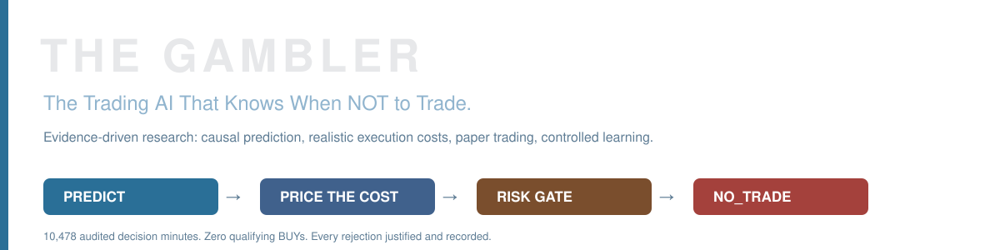
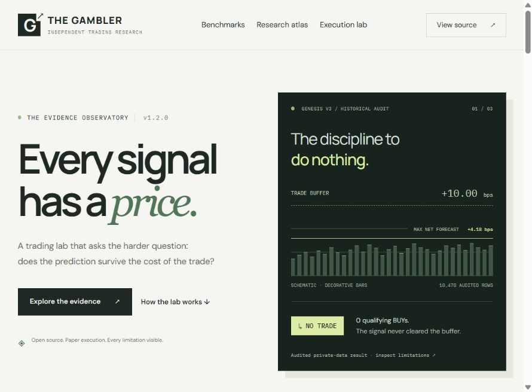
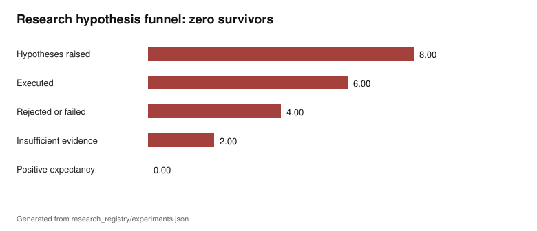
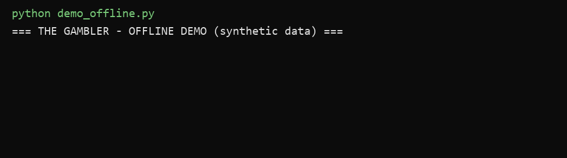
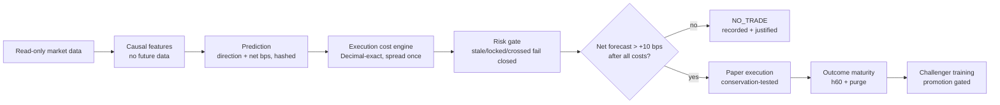
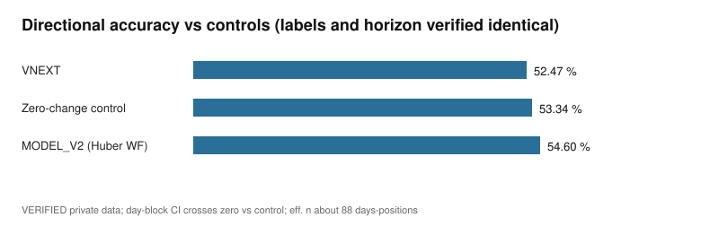
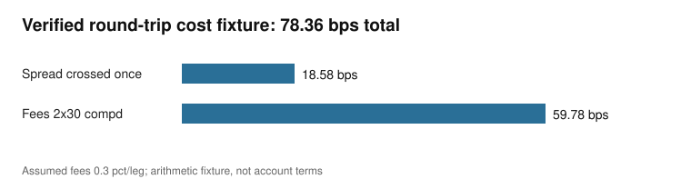

<p align="center"></p>

# THE GAMBLER

## [↗ Open the Evidence Observatory website](https://majidasgharitabrizi.github.io/the-gambler-trading-lab/)

[](https://majidasgharitabrizi.github.io/the-gambler-trading-lab/)

**New: [Evidence Observatory storefront](docs/STOREFRONT.md)** — interactive matched benchmarks, searchable model evidence, all experiment records, and an execution-cost explorer. Run `python -m http.server 4173 --directory storefront` to explore it locally. [Which model is best?](docs/models/BENCHMARK_REVIEW.md)

**The Trading AI That Knows When NOT to Trade.**
*An evidence-driven research system for causal prediction, realistic trading execution, paper trading and controlled learning.*

[](https://github.com/MajidAsghariTabrizi/the-gambler-trading-lab/actions/workflows/tests.yml)
[](https://github.com/MajidAsghariTabrizi/the-gambler-trading-lab/releases)
[](LICENSE)
[](pyproject.toml)

### 📄 Read the Complete Research Study

**[From Predictive Accuracy to Executable Alpha](https://majidasgharitabrizi.github.io/the-gambler-trading-lab/research/from-prediction-to-executable-alpha/)** — a one-year longitudinal case study: how 54.6% directional accuracy became a registered −42.53 bps/trade verdict, and everything the evaluation machinery taught us. *(canonical: GitHub Pages)*

[**🗺️ Explore the Research Atlas**](docs/research/ATLAS.md) · [**▶️ Run the Offline Demo**](#quick-start-3-minutes) · [**📊 Compare the Models**](docs/models/COMPARABLE_BENCHMARKS.md)

---

### Three genuine findings — three *different* evaluation populations

| Finding | Value | Population & status |
|---|---|---|
| Best historical directional accuracy | **54.60%** (vs a 53.34% zero-change control; day-block CI crosses zero) | one labeled h60 direction population; VERIFIED on private data |
| Verified arithmetic fixture | **78.359866 bps** round-trip cost under stated fee assumptions | offline REPRODUCED — [cost math](docs/execution/COST_MATH.md) |
| Genesis V3 gate | **0 qualifying BUYs across 10,478 historical policy rows** (max forecast +4.18 bps vs a +10 bps buffer) | one audited policy window; REPRODUCED from sealed parquet |

> These numbers are **not** from the same experiment, sample or population. Each carries its own evidence status — that discipline is the point of this repository. The headline result: **no strategy in this program's history cleared its execution costs.**

<p align="center"></p>

## Quick start (3 minutes)

```bash
git clone https://github.com/MajidAsghariTabrizi/the-gambler-trading-lab.git
cd the-gambler-trading-lab
pip install -r requirements.txt
python demo_offline.py      # deterministic, offline, no API keys
pytest -q tests             # 27 tests, 2 private-data guards skip
```

Real demo output:

```text
=== THE GAMBLER - OFFLINE DEMO (synthetic data) ===
[BOOK]      bid 20236829289 ask 20274464281 spread 18.58 bps (SYNTHETIC)
[FIXTURE]   1.5M round trip -> 1488246.020070195412777950382 TMN (cost 78.3598661987 bps, exact)
[FORECAST]  net -70.20 bps (synthetic model)
[DECISION]  NO_TRADE - expected_net_below_buffer(+10bps)
```

<p align="left"></p>

## Why it exists



## From dozens of trading experiments to one evidence-driven research system

The machine-readable [Research Atlas registry](research_registry/models.json) records **17 model-family entries** across five first-party research lines (2025-12 → today): early rule systems, the 9-expert smart-trader production line with calibrated gates, cost-corrected Genesis simulators, Victory Fusion, and the unified Gambler runtime with real outcome-feedback learning. Not every entry is a separately verified trained model — the registry says exactly which are `TRAINED_VERIFIED` (8), which are `TRAINED_REPORTED_ONLY`, which are `REJECTED`, and which experiment remains `SEALED` by preregistration. Six registered experiments **failed**; their lessons are documented as first-class results.

**The Atlas is the destination for all of it:** [docs/research/ATLAS.md](docs/research/ATLAS.md)

## Within-population benchmarks only

<p>


</p>

MAE leaderboards are deliberately **split by evaluation population** — [see both charts and why pooling is forbidden](docs/models/COMPARABLE_BENCHMARKS.md).

## Navigate
[Research Atlas](docs/research/ATLAS.md) · [Model registry](docs/models/ALL_MODELS.md) · [Execution economics](docs/execution/COST_MATH.md) · [Reproducibility & limits](docs/reproducibility/REPRODUCIBILITY.md) · [Frozen maker experiment](docs/experiments/MAKER_EXPERIMENT.md) · [Open-source references](docs/references/OPEN_SOURCE_BENCHMARKS.md) · [Contributing](CONTRIBUTING.md) · [Security](SECURITY.md)

## Responsible-research statement

This software **cannot place real orders** — no order-execution code exists. No profitability is claimed anywhere; the program's honest conclusion is that its signals could not pay the execution bill. Trading involves substantial risk; nothing here is investment advice.

## License
MIT — [LICENSE](LICENSE). Market data and some artifacts remain private for data-rights reasons; public numbers derived from them are labeled. See [reproducibility limitations](docs/reproducibility/REPRODUCIBILITY.md).
