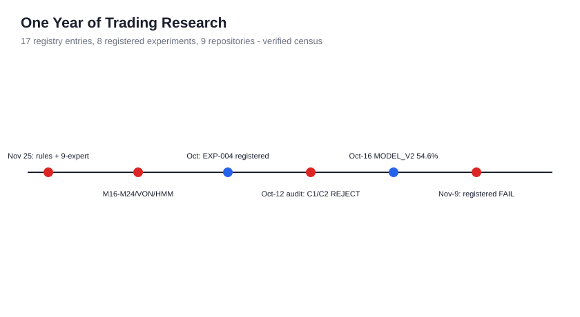
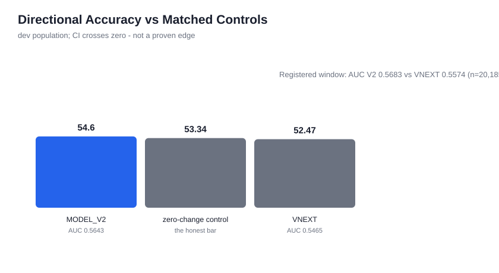
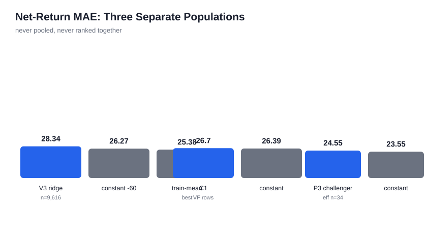
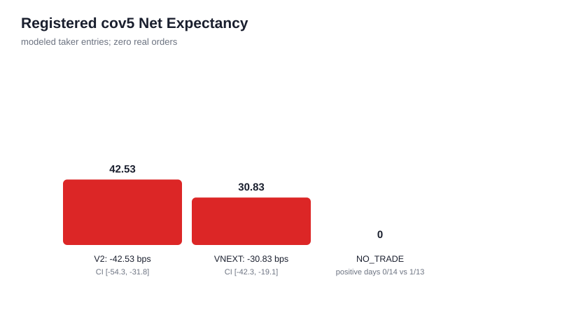
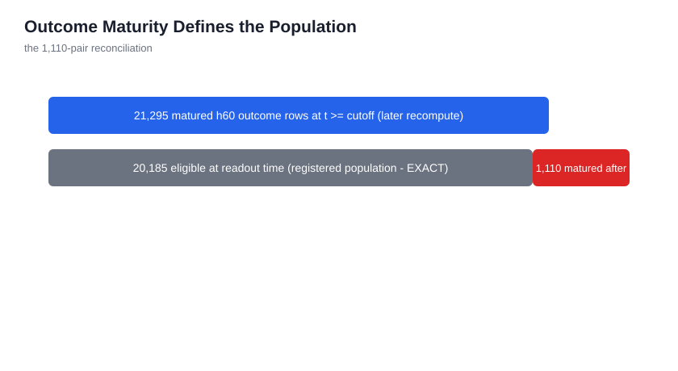
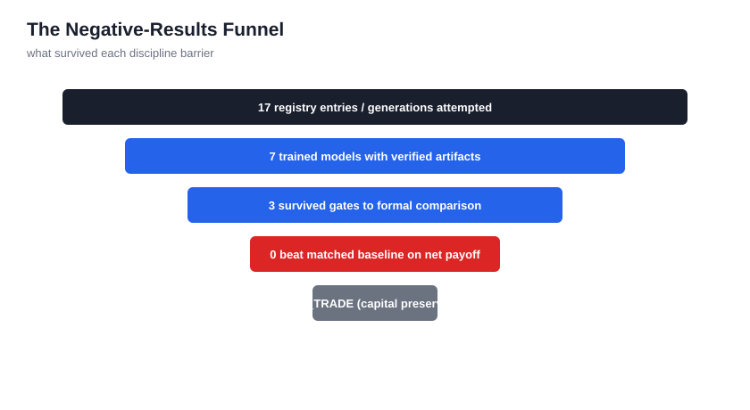
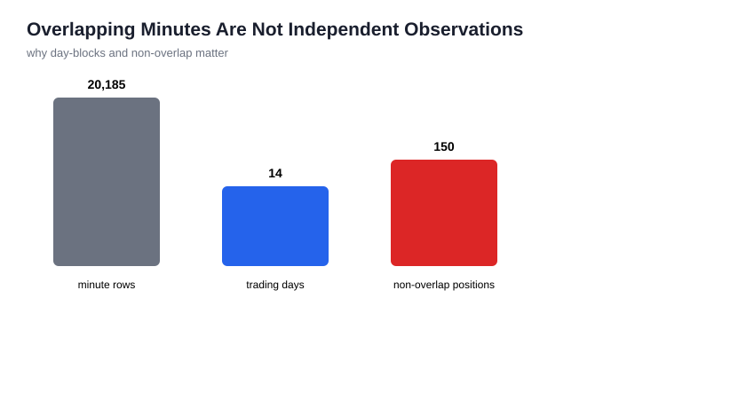
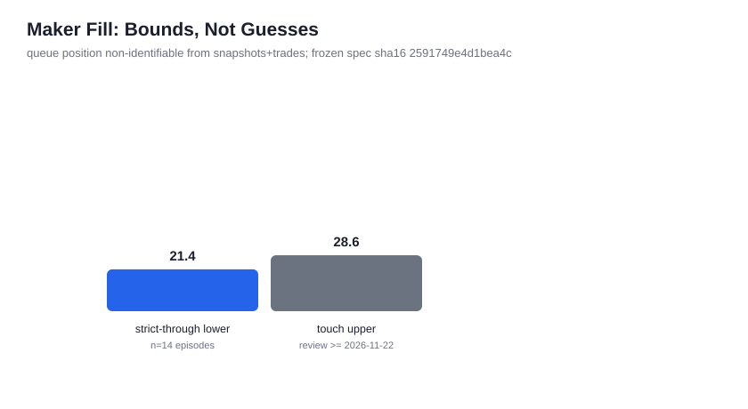

# From Predictive Accuracy to Executable Alpha

**A Longitudinal Case Study of a Cost-Aware Trading Research System**

*November 9, 2026 · Majid Asghari Tabrizi · The Gambler Trading Lab*

1. [Abstract](#abstract)
2. [The Problem: Prediction Is Not Execution](#the-problem)
3. [Research Questions](#research-questions)
4. [The Research Program](#program)
5. [Data Collection and Quality](#data)
6. [Model Families](#families)
7. [Evaluation Methodology](#methodology)
8. [Directional Prediction Results](#direction)
9. [Net-Return Prediction Results](#regression)
10. [The November 9 Registered Evaluation](#nov9)
11. [Execution Costs and Realistic Accounting](#economics)
12. [Learning and Model Promotion](#promotion)
13. [Engineering Failure Analysis](#failures)
14. [Why NO_TRADE Was the Defensible Outcome](#notrade)
15. [Limitations and Threats to Validity](#limits)
16. [The Open Maker Hypothesis](#maker)
17. [Lessons](#lessons)
18. [Conclusion](#conclusion)
19. [References](#references)
20. [Reproducibility Appendix](#repro)

## Abstract {#abstract}

Over approximately one year we built and operated a complete retail-scale trading research system: live market-data collection on a Wallex-hosted BTC/Toman market, a sequence of model generations (rule systems, gradient-boosted ensembles, regime detectors, a nine-expert architecture, adaptive expert fusion, and a Huber walk-forward challenger), a paper-trading runtime with fail-closed safety, a decimal-exact execution-cost model, and a registered, frozen forward-evaluation protocol. The central empirical result is a clean separation between two things that are routinely confused: **measurable directional discrimination and positive net trading expectancy.** Our best directional model achieved 54.60% accuracy versus a 53.34% zero-change control on its development population (a day-blocked confidence interval that crosses zero), and a registered out-of-sample AUC of 0.5683 over 20,185 matured minute-level prediction/outcome pairs. Under the registered causal selection policy with row-specific realized execution costs, the same model's simulated taker trades produced **−42.53 bps per trade** (registered day-block CI [−54.27, −31.80]), **0 of 14 positive trading days**, and −5,333.8 bps cumulative on 150 non-overlapping positions. No trained net-return model ever beat a constant predictor on matched rows. The registered November 9 evaluation rejected both pre-registered incremental hypotheses (T1 microstructure, T2 cross-market lead-lag) with all six frozen gates failing. We report the full lineage — including every negative result and ten engineering defects we found in our own pipeline — with reproduction commands, hashes, and evidence grades. The defensible trading policy was NO_TRADE; the durable asset is the evaluation machinery.

## The Problem: Prediction Is Not Execution {#the-problem}

A model that says "up next hour slightly more often than chance" is not a trading strategy. Between the prediction and the profit stand: bid-ask spread crossed at entry and exit, exchange fees per leg, quantity precision at the exchange layer, fill mechanics, adverse selection, and the statistical dependence of overlapping labels. At retail scale on an illiquid market, these frictions are not a detail — they are the dominant term.

This paper is a longitudinal case study of one research program that took that distinction seriously and measured it end to end. We do not present a profitable strategy, because we did not find one. We present something rarer in public trading research: a complete, registered, independently reconciled record of **why** a sequence of increasingly sophisticated models failed to produce positive net expectancy — and what that teaches about evaluation discipline.

## Research Questions {#research-questions}

1. Can minute-level directional models on a retail crypto-fiat market beat matched controls out of sample?
2. Does any trained net-return forecaster beat a constant predictor on matched rows?
3. Do order-book microstructure (T1) and cross-market lead-lag (T2) features add incremental predictive value over the canonical baseline, under pre-registered gates?
4. What does the gap between directional accuracy and net expectancy look like when measured with row-specific realized costs?
5. Which engineering defects silently corrupt trading research, and how are they caught?

## The Research Program {#program}

The program ran from November 2025 (first-generation structured rule system and the nine-expert "smart trader" stack) through November 9, 2026 (registered scientific readout). The census below is the verified accounting; friendly names were never allowed to inflate it.

**Registry census (verified at the final accuracy audit, commits 0c2459c, 2dc6bb7, 76770a5):** 17 registry entries, of which **7 are trained ML models with verified supporting artifacts** (nine-expert ensemble + router; Genesis V3 ridge; Victory Fusion C1 and C2; MODEL_V2 Huber walk-forward; VNEXT adaptive experts; P3 purged-ridge challenger). The remainder are policies, simulators, gates, controls, one registered experiment readout (EXP-004), one pinned experimental reconstruction, and reported-only historical groups (M16–M24, VON, Feature Factory, HMM, LightGBM/XGBoost/CatBoost generations) whose artifacts were not recovered and which were never ranked. Full table: [Model Census appendix](#appendix-census).

Chronology with first-party sources:

| Period | System | What it was | Outcome |
|---|---|---|---|
| 2025-11 – 2026-01 | structured rules, smart-trader v0–v4 | rule/indicator system; nine-expert ensemble with router | router ablation later showed 0 action flips vs single expert (effective dimension 2.755) — hidden complexity, no value |
| 2026-01 – 2026-06 | M16–M24, VON, Feature Factory, HMM, boosting generations | feature factories, regime detection, GBM ensembles | REPORTED_ONLY — artifacts not recovered; never re-ranked |
| 2026-10-07 | EXP-004 registered | base-rate recalibration experiment | sealed at registration, read out 2026-10-14 under a code-enforced gate; spec SHA pinned, mutation check PASS |
| 2026-10-12 | production audit | kill-switch containment verified after candle-poller stall; gate attribution: uncertainty gate 100% protective abstention; C1/C2 net candidates −24…−28 bps → REJECTED; C3 CI crosses 0 → INSUFFICIENT | research-only policy enforced |
| 2026-10-16 | MODEL_V2 benchmark | Huber walk-forward direction model | 54.60% / AUC 0.5643 vs 53.34% control (CI crosses 0) |
| 2026-10-26 09:53:33Z | L2 registration cutoff | T1/T2 pre-registered | frozen |
| 2026-11-02 | L2 evaluation #1 | endpoint cutoff+7d, n=10,006 | T1 REJECT, T2 REJECT |
| 2026-11-03 | Genesis V2 | cost-corrected paper policy | 5 paper trades, −28.99 bps mean |
| 2026-11-04 | Genesis V3 | ridge net-bps forecaster, sealed parquet (10,478 rows, sha16 9366bd85ad487cdc) | 0 BUY decisions in 10,478 minutes |
| 2026-10-31/11-04 | Victory Fusion C1/C2, P3 challenger | fusion and purged-ridge challengers | both lose to constants on matched rows |
| 2026-11-09 13:00:25Z | **Registered readout** | FINAL_SHADOW_VERDICT_20261109 | **INCREMENTAL_PREDICTIVE_EDGE: FAIL** |

*Figure 1 — Program timeline. Red markers: registered or audited negative verdicts. Source: registry census; command: python scripts/make_paper_figures.py.*

## Data Collection and Quality {#data}

The production VPS (read-only by standing order throughout this research) runs a 1-second WebSocket depth collector and trade-tape recorder across BTCTMN, BTCUSDT and USDTTMN, a 5-minute REST candle poller, and the prediction runtime. Verified at the final audit: 1.45 GB of raw microstructure (books with cumulative sums, trade prints with aggressor side), 102,810 decision-ledger rows, 102,571 outcome-ledger rows, 15-day sealed L2 archive (863,000,352 bytes; one documented restore-day defect of 167,909 lines), coverage 1.0 at 15-minute rollup, 2,737 spread outliers and 108 crossed books on the audit day. Labels are h60 signed returns matured at horizon plus a 71-minute purge; overlapping minutes are never counted as independent.

**Data honesty rules (enforced):** epoch tags (REPLAY / LEGACY_OOS / LIVE_FORWARD / MATURED_LIVE_FORWARD) are never mixed in one number; DATA_MISSING is never reported as zero; insufficient spans are labeled DATA_LIMITED.

## Model Families {#families}

The final census distinguishes trained models from infrastructure. The two systems that reached the registered evaluation are:

**MODEL_V2** — Huber-regressor walk-forward direction model, retrained daily on matured labels only, emitting a live out-of-fold-disabled shadow score stream (model_v2/shadow.jsonl). It is the *challenger* in the registered readout.

**VNEXT** — the adaptive nine-expert production stack (micro_direction, return_surface, magnitude, large_move, path, global_dislocation, event_l2, execution, maker_fill) with calibrated fusion and deterministic NO_TRADE gates. Its frozen direction expert score is the registered *baseline*.

Full feature and target registry: [docs/models/FEATURE_AND_TARGET_REGISTRY.md](../models/FEATURE_AND_TARGET_REGISTRY.md).

## Evaluation Methodology {#methodology}

Three rules governed every number in this paper:

1. **Population discipline.** Metrics are only compared within one evaluation population (same target, horizon, window, sampling). The three regression populations (V3 rows, VF rows, P3 rows) are never pooled or ranked together.
2. **Dependence awareness.** Uncertainty is day-block bootstrapped; positive-day counts and non-overlapping positions (1-hour spacing) carry the economics.
3. **Registration discipline.** Hypotheses, gates, endpoints and cutoffs were frozen in code before outcomes existed; the registered evaluator ran autonomously at its endpoint.

## Directional Prediction Results {#direction}

On the development benchmark population, MODEL_V2 scored 54.60% accuracy / AUC 0.5643 against a 53.34% zero-change control — an apparent 1.26-point edge whose day-blocked confidence interval **crosses zero** (effective independent n ≈ 88). VNEXT scored 52.47% / 0.5465.

On the registered forward window (20,185 matured h60 pairs), MODEL_V2 AUC was 0.5683 vs VNEXT 0.5574. Both values were independently reproduced to four decimals from the raw ledgers during metric reconciliation (commit 76770a5), after correcting an initial score-mapping error in our own audit (see Failure F5). A point-estimate AUC ranking is **not** claimed as statistically significant incremental advantage — that question was assigned to the pre-registered paired gates, which failed.

*Figure 2 — Directional accuracy, development population only. The registered-window AUCs are a separate population and are never averaged into this chart.*

## Net-Return Prediction Results {#regression}

Across three separate populations, no trained model beat its matched constant:

| Population (never pooled) | Model | MAE (bps) | Baseline | Baseline MAE | Grade |
|---|---|---|---|---|---|
| V3 dev rows (n=9,616, 9 days) | Genesis V3 ridge | 28.3363 (RMSE 40.1394, IC −0.0118) | constant −60 | 26.2663 | REPRODUCED |
| V3 dev rows | — | — | train-mean −66.98 | **25.3769** | REPRODUCED |
| VF eval rows | VF C1 | 26.70 | constant −60 | 26.39 | VERIFIED_PRIVATE |
| VF eval rows | VF C2 | 37.47 | constant −60 | 26.39 | VERIFIED_PRIVATE |
| P3 val rows (2 days, eff. n≈34) | P3 challenger | 24.546 | constant −60 | 23.546 | VERIFIED_PRIVATE |

*Figure 3 — Three regression populations, three separate panels. No cross-population ranking is implied or possible.*

The V3-vs-constant comparison is worse than it looks: a paired day-block bootstrap puts the constant's MAE advantage at 2.07 bps with CI [−4.10, −0.11] — borderline but consistent. **Why does a constant beat a trained model?** Because on this market the h60 net-return distribution is dominated by its conditional mean (≈ −67 bps of friction-laden drift in the sample window); a model that chases noise adds variance without adding signal. That is what a near-zero IC (−0.0118) means: rank correlation between forecast and outcome is nil. Low MAE is not profit — selection profit requires the *ordering* of forecasts to be right where trades are taken, which is exactly what failed.

## The November 9 Registered Evaluation {#nov9}

The frozen contract (l2_eval.py / l2_report.py; timer-driven, readout at 13:00:25Z) evaluated:

- **Population:** minute-level pairs with t ≥ cutoff 2026-10-26T09:53:33Z, h60 label matured, realized cost non-null, matured by readout time: **n = 20,185**.
- **T1 (BTCTMN order-book microstructure: imbalance, microprice offset, spread):** dAUC CI [−0.0726, 0.0097]; coverage-5 dAccuracy CI [−0.056, 0.100]; dNet CI [−5.81, 10.96] bps — **REJECT**.
- **T2 (adds BTCUSDT lead-lag lags 0–3 and USDTTMN controls):** dAUC CI [−0.0769, 0.0007]; dAcc CI [−0.0754, 0.0871]; dNet CI [−5.82, 6.19] bps — **REJECT**.
- All six gates failed. Next-candle 1-minute challengers scored AUC 0.5016 / 0.5175 against baseline 0.5973.
- **Registered decision string: INCREMENTAL_PREDICTIVE_EDGE: FAIL.**

*Figure 4 — Registered cov5 net expectancy (modeled taker entries, zero real orders).*

**Economics of the registered cov5 policy** (selection: causal previous-day 95th-percentile threshold on |score|; entry: sign(score); net: sign × realized h60 return − row-specific realized cost; non-overlap: 1-hour spacing; uncertainty: day-block bootstrap B=2000):

| | MODEL_V2 | VNEXT |
|---|---|---|
| Selected signals | 1,295 | 1,447 |
| Net per modeled trade | **−42.53 bps** | −30.83 bps |
| Registered net CI | [−54.27, −31.80] | [−42.26, −19.11] |
| Positive days | **0 / 14** | 1 / 13 |
| Non-overlapping positions | 150 | 145 |
| Cumulative (non-overlap) | −5,333.8 bps | −3,313.4 bps |

These are **modeled taker entries, not exchange fills** — zero real orders were ever placed (LIVE_EXECUTION=OFF throughout; triple-gated, no unlock file).

*Figure 5 — Why the population is maturity-bounded: the 1,110-pair reconciliation.*

**Independent reconciliation (commit 76770a5).** We recovered the frozen evaluator source read-only and reran it verbatim on the raw ledgers. Every headline number reproduced exactly: n=20,185; AUCs 0.5683/0.5574; cov5 trades, nets, day counts, non-overlap and cumulative values identical. Two honest notes: (1) our first independent attempt returned 21,295 pairs — the 1,110-pair surplus was fully attributed to outcomes that matured *after* the readout; the registered population is maturity-bounded by definition. (2) Bootstrap CI endpoints differed by ≤ 0.4 bps ([−53.89, −31.96] on rerun) because the original report's RNG stream had consumed draws before the economics block; same method, same data, different stream state. We do not claim bit-identical intervals.

## Execution Costs and Realistic Accounting {#economics}

The public repository pins a decimal-exact accounting fixture (spread crossed once; fees per leg compounded in quote currency; full-precision quantities; explicit 8-decimal exchange layer): capital 1,500,000 TMN, ask 20,438,907,946, bid 20,400,971,155, illustrative fee 0.003/leg → returned cash 1,488,246.0200701954 TMN, loss 11,753.9799298046 TMN, cost **78.3598661987 bps**, reproduced offline to 1e-9.

This fixture is an **arithmetic regression test, not a market measurement**. The registered November 9 economics use row-specific realized costs from the outcome ledger — a different, stronger analysis. Measured taker friction regimes across the program ranged 66–97 bps; a 1.5M-ticket BTCUSDT sweep was shown infeasible (1.43M unfilled); USDTTMN depth was 0.15–0.30 bps deep. The illustrative fee is **not** a verified account-tier fee — account-specific fees remain UNVERIFIED.

## Learning and Model Promotion {#promotion}

Every challenger faced a promotion gate it had to beat on matched rows: P3 challenger lost to the constant (24.546 vs 23.546) → SHADOW, never promoted; VF C1/C2 rejected; the production-era C1/C2 net candidates measured −24…−28 bps → REJECTED; C3's CI crossed zero → INSUFFICIENT_EVIDENCE. EXP-004 (base-rate recalibration) was the template for discipline: registered with a spec SHA, mutation-checked, read out at a code-enforced gate, and its verdict vocabulary fixed in advance (REJECT / CONTINUE_SHADOW).

## Engineering Failure Analysis {#failures}

Ten confirmed defects, each with symptom, root cause, correction, regression test, and generalizable lesson. Full detail in [docs/research/FAILED_HYPOTHESES.md](../research/FAILED_HYPOTHESES.md) and the private audit; summary:

| # | Defect | Lesson |
|---|---|---|
| F1 | Spread double-counted in early cost math | Write the cost fixture before the strategy |
| F2 | Fees applied on wrong accounting basis | Fees are per-leg, quote-currency, compounded |
| F3 | BTC quantity-precision distortion | Make the 8-dp exchange layer explicit and tested |
| F4 | Feature/artifact parity drift (local reconstruction corr −0.08 vs audited V3) | Pin artifact hashes; parity-check before any comparison |
| F5 | Independent audit mapped V2/VNEXT score fields wrongly (0.5618 vs 0.5683) | Verify score lineage from evaluator source, not field names |
| F6 | Population mismatch: 1,110 post-readout maturities inflated a rerun | Eligibility = maturity at readout time, by definition |
| F7 | Overlapping minute labels treated as independent | Day-block everything; count non-overlapping positions |
| F8 | Maker fills non-identifiable from snapshots+trades | Report bounds only; queue position is not in the data |
| F9 | Ensemble router added complexity with 0 action flips | Ablate before you architect |
| F10 | Metrics compared across differing populations | One population per table, always labeled |

*Figure 6 — What survived each discipline barrier.*

## Why NO_TRADE Was the Defensible Outcome {#notrade}

Not because the models were silent: 18,890 of 20,185 minutes abstained under the cov5 policy, and the 1,295 minutes that did signal lost −42.53 bps per modeled trade with a confidence interval entirely below zero and not one positive trading day in fourteen. The paper account ends with 15,000,000 TMN preserved and PnL exactly 0 — **not** a claim of skill; abstention avoided a measured negative, which is the only claim the evidence supports.

*Figure 7 — Minute rows are not independent observations.*

## Limitations and Threats to Validity {#limits}

- One market (BTC/TMN), one year, retail scale. No claim extends to other venues, assets, or regimes.
- The tested policies are taker-modeled; maker execution is an open hypothesis (next section).
- Account-tier fees unverified; conclusions are robust to fee=0 because gross edge never materialized.
- Directional AUC 0.5683 is real but modest; the paired incremental gates — the statistically loaded tests — all failed.
- Development-era numbers (54.60%) rest on private data; reproduction requires the private ledgers (documented limitation, not hidden).
- Reported-only generations (M16–M24, VON, HMM, boosting) were never re-verified and are excluded from all ranked claims.

## The Open Maker Hypothesis {#maker}

Frozen experiment EXPERIMENT_MAKER_BTCTMN_v1 (sha16 2591749e4d1bea4c, verified from disk at the final audit) tests whether passive execution can beat the measured taker friction. Bounds methodology from existing tape: strict-through lower bound 21.4%, touch upper bound 28.6% (n=14). Queue position is non-identifiable from snapshots — a permanent data limitation, so the experiment reports bounds, never fills. Earliest review 2026-11-22, conditional on ≥100 eligible entries, 30 episodes, 10 days. No future observations were accessed; no thresholds changed. Maker execution is a separate open question, not a strategy.

*Figure 8 — Identifiable bounds only; queue position is not in the data.*

## Lessons {#lessons}

1. **A constant is a model.** Beating zero-change is not beating the right baseline; the right baseline is the best trivial predictor on the same rows.
2. **Registered protocols protect you from yourself.** The Nov-9 verdict ran without human intervention and said FAIL. Every earlier unregistered "improvement" did not survive registration.
3. **Costs are the strategy at retail scale.** 66–97 bps friction erases a 1.3-point accuracy edge.
4. **Ablate complexity.** Nine experts and a router produced 0 flips versus one expert.
5. **Reconcile, don't trust.** Our own audit made the F5 mapping error; exact reconciliation from source is what caught it.
6. **Negative results are publishable.** This entire program's durable output is evaluation machinery and an honest ledger.

## Conclusion {#conclusion}

We built a trading AI and measured it against reality at every stage. Directional signal existed (AUC 0.5683 registered). Economic edge did not (−42.53 bps/trade, CI [−54.27, −31.80], 0/14 days). No trained forecaster beat a constant. The registered evaluation closed the incremental questions we could pose at this data depth; the verbatim conclusion stands: *1-minute BTCTMN prediction is information-complete at this data depth; the remaining path is cost engineering, not prediction.* The system's final action was its most disciplined: it did not trade.

## References {#references}

- Registered verdict artifact FINAL_SHADOW_VERDICT_20261109.md (sha256 0061cea333cce2f7cfed7238642d7dc11fd0f5b6cea022204d5044eb769dc076) and l2eval.json (sha256 cde655c70d30a78cc92f8ceb3cbd74bcc0591a7e219cebb91effd2c830601907) — private VPS, read-only; hashes public.
- Final accuracy audit and metric reconciliation: private commits 0c2459c, 2dc6bb7, 76770a5, bb4db50.
- Public: [Research Atlas](ATLAS.md) · [Comparable Benchmarks](../models/COMPARABLE_BENCHMARKS.md) · [Execution Economics](../execution/COST_MATH.md) · [Maker Experiment](../experiments/MAKER_EXPERIMENT.md) · [Failed Hypotheses](FAILED_HYPOTHESES.md) · [Reproducibility](../reproducibility/REPRODUCIBILITY.md)
- Cerulean Research / López de Prado-style advanced benchmarking practices inform the population-discipline and deflated-significance stance; no external results are reused as claims.

## Reproducibility Appendix {#repro}

~~~bash
git clone https://github.com/MajidAsghariTabrizi/the-gambler-trading-lab
cd the-gambler-trading-lab
python -m pytest -q            # 29 tests incl. decimal fixture (78.3598661987 bps, tol 1e-9)
python demo_offline.py         # deterministic synthetic-public demo
python scripts/make_paper_figures.py   # regenerates all figures in figures/paper/
~~~

Evidence grades used throughout: EXACTLY_REPRODUCED / REPRODUCED_WITH_LIMITATIONS / VERIFIED_PRIVATE / HASH_VERIFIED_ONLY / REPORTED_ONLY / REJECTED / INSUFFICIENT_EVIDENCE. Which numbers fall in which grade: see [paper_metrics.json](../../research_registry/paper_metrics.json) and the claims table in [PAPER_EVIDENCE_MANIFEST.json](../../research_registry/PAPER_EVIDENCE_MANIFEST.json). Private-ledger metrics (registered readout details, dev benchmarks) are marked accordingly and cannot be recomputed from the public tree — that is a stated limitation, not a gap in disclosure.

## Appendix: Model Census {#appendix-census}

17 entries — 7 trained-with-artifacts, 2 policy/simulator systems, 2 risk-gate infrastructure, 1 registered experiment readout, 1 pinned experimental reconstruction, 1 filter (insufficient n), 2 reported-only groups, 1 control. Machine-readable: [ALL_MODELS_AND_VERSIONS.csv](https://github.com/MajidAsghariTabrizi/the-gambler-trading-lab/blob/master/research_registry/paper_models_census.csv).

*This work is not peer-reviewed. It is a first-party engineering case study with registered protocols, hash-pinned artifacts, and independently reconciled headline numbers.*
